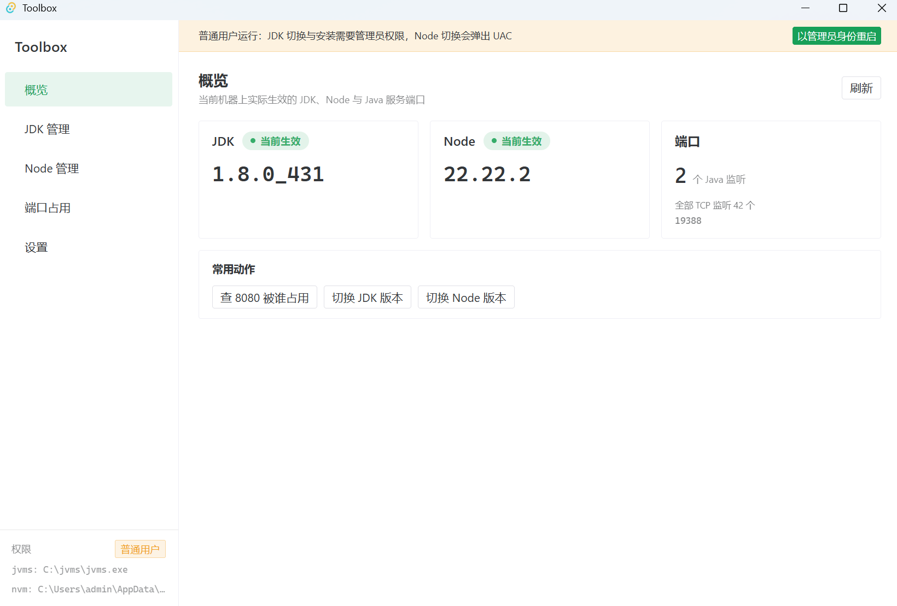
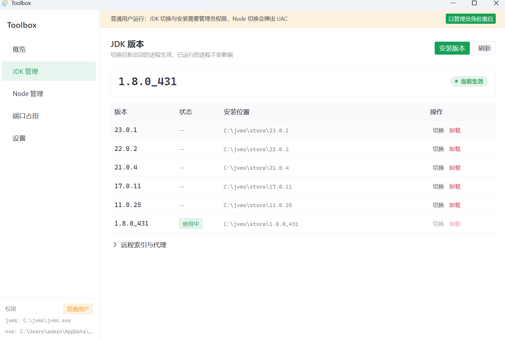
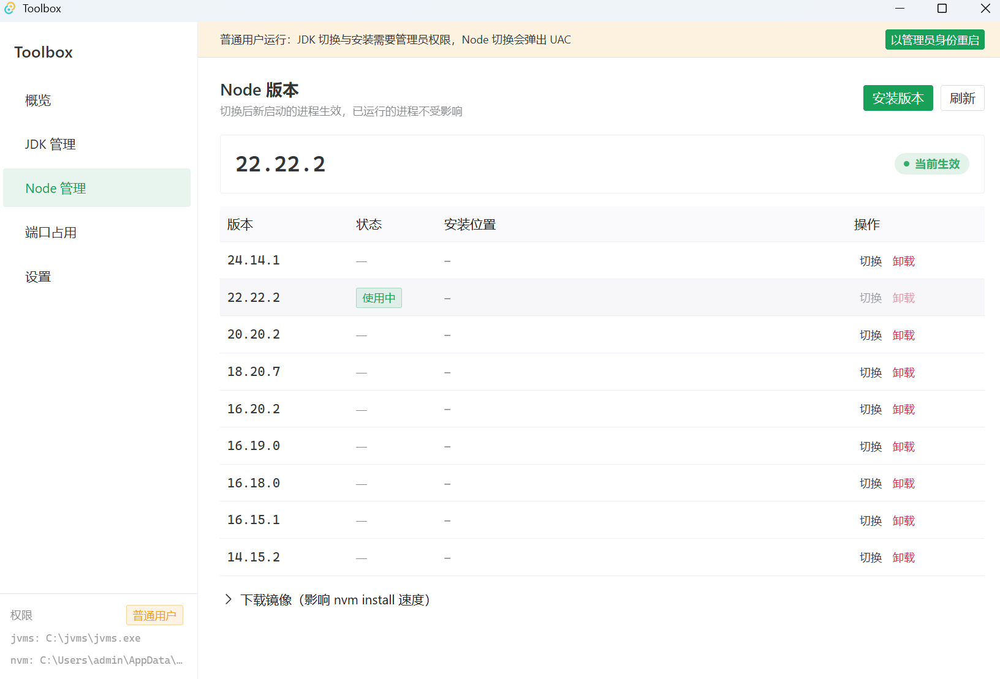
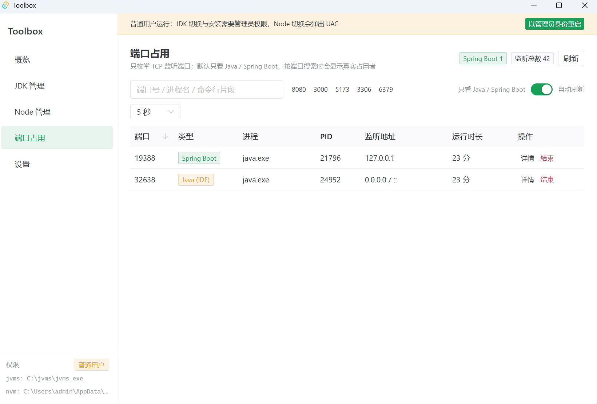
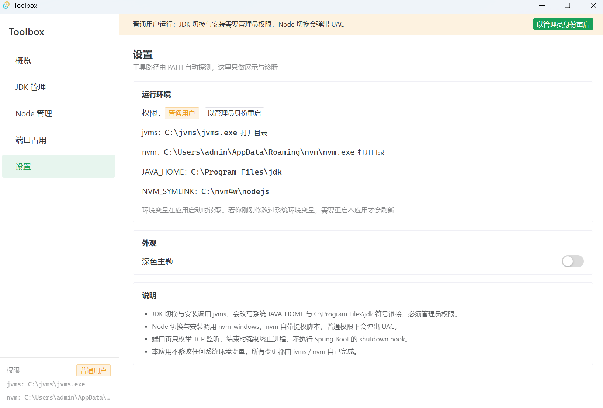

# Toolbox

Windows 本地开发环境控制台，把三件命令行琐事放进一个窗口：

- 查看和切换 jvms 管理的 JDK 版本，支持安装、卸载、远程版本列表。
- 查看和切换 nvm-windows 管理的 Node 版本，支持安装、卸载、远程版本列表。
- 枚举 TCP 监听端口，识别 Spring Boot 进程，一键结束并确认端口释放。



## 功能

### 概览

打开即是概览页：当前生效的 JDK、Node 版本，本机 Java 监听数量与 Spring Boot 端口。点击卡片进入对应页面。

### JDK 管理



- 版本列表来自 `jvms list`，当前版本与符号链接目标、`java -version` 三方比对，不一致时给出告警。
- 切换调用 `jvms switch`，修改全局符号链接，新启动的进程立即生效。
- 支持远程版本列表、安装、卸载；当前使用中的版本禁止卸载。
- JDK 操作需要管理员权限，非管理员时页面顶部提供“以管理员身份重启”。

### Node 管理



- 版本列表来自 `nvm list`，与 `C:\nvm4w\nodejs` 链接目标、`node -v` 比对。
- 切换调用 `nvm use`，nvm 自带提权脚本，可能弹出 UAC。
- 支持远程版本列表、安装、卸载。
- 底部可查看并设置 node / npm 下载镜像，写入 nvm 的 `settings.txt`。

### 端口占用



- 通过 `GetExtendedTcpTable` 直接读取 TCP 监听表，只保留 LISTEN 状态，不解析 `netstat` 文本。
- 按命令行识别 `Spring Boot`、`Java`、`Java (IDE)`、`Node`、`Docker`，界面始终展示命令行原文供核对。
- 同一进程的 IPv4 / IPv6 双栈监听合并为一行，地址显示为 `0.0.0.0 / ::`。
- 默认只看 Java / Spring Boot；按端口号或进程名搜索时绕过过滤，显示真实占用者。
- 支持自动刷新、快捷端口、详情抽屉、结束进程并轮询确认端口释放。
- 系统关键进程禁止结束；Docker 端口代理会额外提示结束它不会停止容器。

### 设置



- 展示 jvms / nvm 路径、`JAVA_HOME`、`NVM_SYMLINK`，可直接打开工具目录。
- 切换深色 / 浅色主题。
- 非管理员时可从设置页重启提权。

## 环境要求

- Windows 10 / 11
- 已安装 [jvms](https://github.com/ystyle/jvms)（`jvms.exe` 在 PATH 中）与 [nvm-windows](https://github.com/coreybutler/nvm-windows)
- 运行需要 WebView2 Runtime（Windows 11 自带）
- 构建需要 Node 20.19+、Rust 1.85+（edition 2024）、VS Build Tools（MSVC）

## 技术栈

- 桌面壳：Tauri 2
- 前端：Vue 3 + TypeScript + Vite + Naive UI
- 系统调用：Rust + `windows` crate（TCP 表、进程信息、符号链接、管理员检测）

## 目录结构

| 路径 | 说明 |
|---|---|
| `src/` | 前端页面、组件与 API 封装 |
| `src-tauri/src/` | Rust 命令与系统调用 |
| `docs/design.md` | 设计文档：范围、界面、实现、计划、风险 |
| `assets/` | README 截图 |
| `package.bat` | 打包脚本 |

## 开发

```bash
npm install
npm run tauri dev
```

前端单独调试：

```bash
npm run dev
```

## 构建

推荐用项目根目录的 `package.bat`，双击或命令行运行均可：

```bat
package.bat
package.bat exe
package.bat debug
```

| 命令 | 作用 |
|---|---|
| `package.bat` | 完整打包：exe + MSI + NSIS 安装包 |
| `package.bat exe` | 只出单个 exe，不生成安装包（更快） |
| `package.bat debug` | debug 版本，便于定位问题 |

脚本会检查 node / cargo、缺依赖时自动 `npm install`、清理旧安装包，最后打印产物路径。

产物位置：

| 文件 | 路径 |
|---|---|
| 免安装 exe | `src-tauri/target/release/toolbox.exe` |
| MSI 安装包 | `src-tauri/target/release/bundle/msi/Toolbox_<version>_x64_en-US.msi` |
| NSIS 安装包 | `src-tauri/target/release/bundle/nsis/Toolbox_<version>_x64-setup.exe` |

也可以直接用原生命令：

```bash
npm run tauri build
```

## 权限说明

- JDK 切换、安装、卸载需要管理员权限：jvms 会改写系统 `JAVA_HOME` 并重建 `C:\Program Files\jdk` 符号链接。非管理员运行时页面顶部会提示，可点击“以管理员身份重启”。
- Node 切换与安装由 nvm-windows 自己提权，可能弹出 UAC。
- 端口查询与结束普通权限即可，但读取管理员进程的命令行、结束管理员进程需要提升权限。

## 已知限制

- jvms 的远程索引位于 `raw.githubusercontent.com`，国内网络常不可达，安装 JDK 前需要先给 jvms 配代理。
- 端口页只枚举 TCP 监听（HTTP 服务都在其中），不做 UDP 与已建立连接。
- 结束进程使用 `TerminateProcess`，Spring Boot 的 shutdown hook 不会执行，未刷盘的数据可能丢失。
- “只看 Java / Spring Boot”基于命令行启发式判断，只作为辅助，判断依据以详情里的命令行为准。
- 应用启动时读取环境变量，修改系统环境变量后需要重启应用才会刷新。
